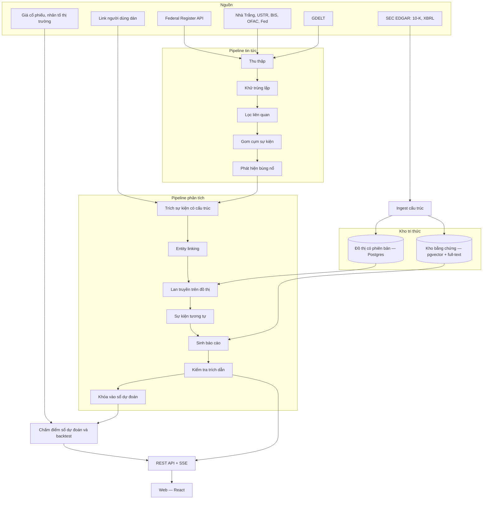

# Butterflynomics — Proposal bản MVP (v0.3)

***First the panic. Then the pattern.***

When economic news breaks, emotion moves first. Butterflynomics traces how a policy ripples through industries and companies — with evidence for every claim.

> **Dán một bài báo về chính sách kinh tế mới, nhận lại bản phân tích chuyên sâu: tác động lan tới ngành và công ty nào, qua đường nào, có lợi hay bất lợi, kèm bằng chứng cho từng nhận định. Hệ thống tự theo dõi tin nóng, và công khai chấm điểm độ chính xác của chính mình theo thời gian.**

| Mục | Nội dung |
|---|---|
| Tác giả | Nguyễn Phương Duy |
| Loại | Project cá nhân cỡ đồ án — portfolio Backend |
| Nền tảng | Web |
| Thời lượng | 12 tuần, có cổng kiểm tra khả thi cuối tuần 2 |
| Phiên bản | v0.3 — bản MVP, thay thế phạm vi của v0.2 |
| Ngày | 10/10/2026 |

**Cách đọc:** thuật ngữ chuyên ngành có chú thích ngắn *(in nghiêng trong ngoặc)* ở lần xuất hiện đầu. Bảng thuật ngữ ở mục 20.

---

## 1. Tóm tắt

Khi một chính sách kinh tế mới được công bố (áp thuế, cấm xuất khẩu chip, tăng lãi suất…), người đọc tin thường chỉ biết "thị trường lo ngại". Câu hỏi thật là: **ai bị ảnh hưởng, qua kênh nào, mạnh cỡ nào, và dựa trên bằng chứng gì?**

MVP của Butterflynomics gồm ba khả năng:

1. **Phân tích theo yêu cầu.** Người dùng dán link hoặc nội dung bài báo. Hệ thống trích ra sự kiện có cấu trúc, lan truyền nó trên **đồ thị tri thức** *(mạng lưới nối công ty, ngành, sản phẩm, quốc gia và chính sách bằng các quan hệ có số liệu)*, rồi viết bản phân tích mà **mỗi nhận định đều trỏ về bằng chứng**.
2. **Theo dõi tin nóng.** Hệ thống tự thu thập từ nguồn chính thức của chính phủ Mỹ và nguồn tin mở, phát hiện sự kiện đang được nói tới nhiều, và tự phân tích các sự kiện nóng nhất.
3. **Tự chấm điểm công khai.** Mọi bản phân tích được đóng dấu thời gian và khóa lại. Vài ngày sau, hệ thống so với phản ứng thật của giá cổ phiếu và công bố kết quả trên **sổ dự đoán**.

**Định vị:** công cụ phân tích phơi nhiễm *(mức độ một công ty dính dáng tới một cú sốc)* và giải thích. **Không** dự đoán giá, **không** khuyến nghị mua bán.

---

## 2. Vấn đề và khoảng trống

| Cách hiện tại | Hạn chế |
|---|---|
| Đọc báo | Biết sự kiện, không biết tác động bậc 2, bậc 3 qua chuỗi cung ứng |
| Dán bài vào ChatGPT | Văn trôi chảy nhưng không kiểm chứng được; dễ bịa; không có số liệu cụ thể của từng công ty |
| Phân loại theo ngành | Quá thô: hai công ty cùng ngành có thể phơi nhiễm rất khác nhau |
| Terminal chuyên nghiệp *(phần mềm dữ liệu tài chính trả phí như Bloomberg)* | Đắt, đóng, không giải thích theo đường lan truyền |

Khoảng trống: phân tích **có cấu trúc, có bằng chứng, đúng về thời gian, và tự công khai độ chính xác**.

---

## 3. Luận điểm

> Kết hợp đồ thị tri thức có phiên bản theo thời gian (phần suy luận, do thuật toán tất định đảm nhiệm) với LLM chỉ làm nhiệm vụ đọc và viết trên bằng chứng (phần ngôn ngữ), cho ra phân tích tác động chính sách vừa giải thích được, vừa kiểm chứng được bằng phản ứng thật của thị trường.

Nguyên tắc thiết kế xuyên suốt: **LLM đọc và viết; thuật toán suy luận; dữ liệu làm chứng.**

---

## 4. Người dùng và kịch bản

| Người dùng | Nhu cầu |
|---|---|
| Người đọc tin kinh tế, chính trị (người dùng chính, gồm chính tác giả) | Hiểu một chính sách mới tác động thế nào mà không cần kiến thức tài chính chuyên sâu |
| Nhà tuyển dụng, người xem portfolio | Mở link, trong 3 phút thấy được hệ thống làm gì và làm tốt tới đâu |

**Kịch bản chính:**

1. *"Sáng nay Mỹ công bố thuế mới lên linh kiện điện tử."* Người dùng dán link bài báo. Sau khoảng 30–60 giây, nhận bản phân tích: các ngành và công ty bất lợi, có lợi; đường lan truyền; sự kiện tương tự trong quá khứ và phản ứng khi đó; những điều có thể làm phân tích sai.
2. Người dùng thử **kịch bản giả định**: "nếu thuế là 60% thay vì 25%?", "nếu miễn trừ cho chất bán dẫn?" — bảng xếp hạng cập nhật ngay.
3. Người dùng mở trang chủ, thấy danh sách **tin nóng** hệ thống tự phát hiện trong 24 giờ qua, bấm vào xem phân tích.
4. Nhà tuyển dụng mở **sổ dự đoán** và **trang kiểm chứng** để xem hệ thống đúng sai thế nào.

---

## 5. Phạm vi MVP

### 5.1 Tính năng

| Ưu tiên | Tính năng | Mô tả ngắn |
|---|---|---|
| **P0** | Phân tích theo yêu cầu | Dán link/văn bản → bản phân tích có trích dẫn |
| **P0** | Bản phân tích có kiểm soát bằng chứng | Mỗi câu có trích dẫn hợp lệ; câu không có bằng chứng bị gắn nhãn "suy đoán" hoặc bị loại; có chỉ số độ phủ |
| **P0** | Mục "Điều gì có thể làm phân tích này sai" | Kịch bản ngược chiều, yếu tố chưa có trong dữ liệu |
| **P0** | Bản đồ lan truyền | Đồ thị tương tác, bấm cạnh để xem đoạn bằng chứng và tài liệu gốc |
| **P0** | Kịch bản giả định (what-if) | Chỉnh mức thuế, phạm vi quốc gia, miễn trừ ngành → xếp hạng cập nhật tức thì |
| **P0** | Sự kiện lịch sử tương tự | Tìm sự kiện cũ giống nhất và cho thấy thị trường đã phản ứng thế nào |
| **P0** | Tin nóng | Thu thập tự động, khử trùng lặp, gom cụm, phát hiện bùng nổ, tự phân tích cụm nóng nhất (có trần số lượng mỗi ngày) |
| **P0** | Sổ dự đoán | Khóa bản phân tích kèm thời gian; tự chấm sau 3–5 ngày giao dịch; công khai |
| **P0** | Trang kiểm chứng | Kết quả **backtest** *(chạy hệ thống trên các sự kiện quá khứ để kiểm tra)* và so với cách đơn giản |
| **P0** | Chú thích thuật ngữ | Di chuột vào thuật ngữ để xem giải thích ngắn |
| **P0** | Giám sát hệ thống | Chi phí LLM mỗi phân tích, tỉ lệ câu có trích dẫn, thời gian xử lý |
| P1 | Du hành thời gian | Chọn ngày T để xem đồ thị đúng như hệ thống biết lúc đó |
| P1 | Trang công ty | Quan hệ của công ty và mức phơi nhiễm qua các sự kiện |
| P1 | Chế độ Cơ bản / Chuyên sâu | Hai mức trình bày cho bản phân tích |

P0 là điều kiện hoàn thành MVP. P1 làm nếu còn thời gian.

### 5.2 Họ sự kiện được hỗ trợ

Mỗi họ cần **kênh truyền dẫn** *(con đường tác động đi từ chính sách tới công ty)* và dữ liệu riêng:

| Họ sự kiện | Kênh truyền dẫn chính | Dữ liệu |
|---|---|---|
| Thương mại, thuế quan | Doanh thu theo khu vực; linh kiện, nguyên liệu nhập khẩu; đối thủ trong nước | Doanh thu theo khu vực từ báo cáo; mã hàng bị đánh thuế |
| Kiểm soát xuất khẩu, trừng phạt | Doanh thu từ nước bị nhắm tới; mảng sản phẩm bị hạn chế (ví dụ chip cao cấp) | Doanh thu theo khu vực; phân loại mảng sản phẩm |
| Lãi suất (quyết định của Fed *(Cục Dự trữ Liên bang Mỹ, cơ quan quyết định lãi suất)*) | Gánh nặng nợ vay; độ nhạy của ngành với chi phí vốn | Tỉ lệ nợ trên vốn từ báo cáo tài chính; phân loại ngành |

Sự kiện ngoài ba họ này vẫn được tóm tắt và trích xuất, nhưng bản phân tích ghi rõ: *"chưa có mô hình truyền dẫn cho loại sự kiện này, không xếp hạng phơi nhiễm."*

### 5.3 Độ phủ dữ liệu

- Khoảng **80 công ty** trong S&P 500 *(chỉ số 500 công ty lớn niêm yết tại Mỹ)*, chọn từ 6 nhóm: phần cứng và bán dẫn, ô tô, bán lẻ, thép và kim loại, nông nghiệp, bất động sản và tiện ích (cho họ lãi suất).
- Công ty ngoài danh sách không được xếp hạng; bản phân tích hiển thị chỉ số độ phủ để người đọc biết giới hạn.

### 5.4 Ngoài phạm vi MVP

- Dự đoán giá, tín hiệu giao dịch, khuyến nghị đầu tư.
- Tài khoản người dùng, danh sách theo dõi, thông báo đẩy.
- Họ sự kiện khác, thị trường Việt Nam.
- Phân tích cảm xúc mạng xã hội.
- Chatbot hỏi đáp tự do.
- App mobile native.

---

## 6. Ứng dụng Web

### 6.1 Nguyên tắc

- **Tính trước, đọc nhanh.** Bản phân tích tin nóng và kết quả kiểm chứng được tính sẵn. Người xem không kích hoạt LLM, trừ khi dùng tính năng dán bài (có giới hạn số lần).
- **Mọi con số đều bấm vào được** để lần về bằng chứng và tài liệu gốc.
- **Minh bạch:** trang kiểm chứng và sổ dự đoán luôn công khai, kể cả khi kết quả không đẹp.

### 6.2 Màn hình

| # | Màn hình | Nội dung |
|---|---|---|
| 1 | **Trang chủ — Tin nóng** | Các cụm sự kiện nóng trong 24–72 giờ, mức độ nóng, họ sự kiện, link tới bản phân tích |
| 2 | **Phân tích bài báo** | Ô dán link/văn bản; thanh tiến độ theo từng bước xử lý |
| 3 | **Bản phân tích** | Báo cáo theo mẫu ở mục 9.3; bảng xếp hạng; bản đồ lan truyền thu gọn |
| 4 | **Bản đồ lan truyền** | Đồ thị tương tác toàn màn hình; bấm cạnh xem bằng chứng |
| 5 | **Kịch bản giả định** | Thanh trượt và lựa chọn tham số; xếp hạng thay đổi tức thì, so sánh với kịch bản gốc |
| 6 | **Sổ dự đoán** | Danh sách các phân tích đã khóa, trạng thái chấm điểm, độ chính xác tích lũy theo thời gian |
| 7 | **Kiểm chứng** | Kết quả backtest, so với cách đơn giản, giới hạn |
| 8 | **Quản trị** (riêng tác giả) | Trạng thái job, lỗi, chi phí, chất lượng trích dẫn |

---

## 7. Kiến trúc



Chú thích:
- **Federal Register** *(công báo chính thức của chính phủ Mỹ, nơi đăng các quyết định; có API miễn phí)*.
- **USTR** *(Văn phòng Đại diện Thương mại Mỹ)*, **BIS** *(cơ quan Bộ Thương mại Mỹ ban hành kiểm soát xuất khẩu)*, **OFAC** *(cơ quan Bộ Tài chính Mỹ ban hành trừng phạt)*.
- **GDELT** *(cơ sở dữ liệu mở theo dõi tin tức toàn cầu, cập nhật khoảng mỗi 15 phút)*.
- **SEC EDGAR** *(kho hồ sơ công khai của Ủy ban Chứng khoán Mỹ)*, **10-K** *(báo cáo thường niên bắt buộc của công ty niêm yết)*, **XBRL** *(định dạng báo cáo tài chính máy đọc được)*.
- **SSE** *(Server-Sent Events — server đẩy cập nhật tiến độ xuống trình duyệt)*.

---

## 8. Pipeline tin tức (tin nóng)

| Bước | Việc làm | Điểm kỹ thuật |
|---|---|---|
| 1. Thu thập | Gọi định kỳ các nguồn chính thức và GDELT | Mỗi bài là một job **idempotent** *(chạy lại không tạo dữ liệu trùng)*; giới hạn tốc độ; tôn trọng robots.txt |
| 2. Khử trùng lặp | Nhận ra các bài gần giống nhau | **SimHash** *(tạo "dấu vân tay" cho văn bản để phát hiện bài gần trùng)* |
| 3. Lọc liên quan | Bài có nói về chính sách kinh tế không? | Bộ phân loại rẻ chạy trước; chỉ bài lọt qua mới tốn tiền gọi LLM |
| 4. Gom cụm | Gộp các bài cùng nói về một sự kiện | So khớp trên thực thể và thời gian, kết hợp vector ngữ nghĩa |
| 5. Phát hiện bùng nổ | Đánh dấu cụm đang nóng | `z = (n_t − μ) / σ`: số bài trong cửa sổ hiện tại so với trung bình và độ lệch chuẩn của các cửa sổ trước; ngưỡng khởi đầu `z > 3`, chỉnh theo thực tế |
| 6. Kích hoạt phân tích | Gửi cụm nóng sang pipeline phân tích | **Trần số phân tích tự động mỗi ngày** để kiểm soát chi phí |

**Tuân thủ:** chỉ lưu dữ kiện đã trích, link và đoạn trích ngắn từ báo chí; không đăng lại toàn văn bài báo trên web công khai. Nguồn chính thức của chính phủ được ưu tiên vì đó là nguồn gốc của sự kiện chính sách.

---

## 9. Pipeline phân tích

### 9.1 Các bước

1. **Lấy nội dung:** tải bài từ link người dùng dán, hoặc nhận cụm tin từ pipeline tin tức.
2. **Trích sự kiện có cấu trúc:** LLM điền theo JSON schema: họ sự kiện, cơ quan ban hành, đối tượng, sản phẩm/ngành, mức độ, ngày công bố, ngày hiệu lực. Output không khớp schema thì retry hoặc báo lỗi.
3. **Entity linking:** nối các cụm từ trong bài với nút trong đồ thị (ví dụ "các hãng chip Mỹ" → nhóm công ty bán dẫn). Mỗi liên kết có điểm tin cậy; liên kết yếu được hiển thị để người dùng thấy.
4. **Lan truyền** (mục 11) trên đồ thị tại thời điểm công bố sự kiện.
5. **Tìm sự kiện lịch sử tương tự** và lấy kết quả phản ứng thị trường khi đó.
6. **Sinh báo cáo:** LLM chỉ nhận đầu vào gồm sự kiện đã trích, các đường lan truyền, đoạn bằng chứng và kết quả sự kiện tương tự.
7. **Kiểm tra trích dẫn:** tách báo cáo thành từng câu; câu nhận định nào không có mã trích dẫn hợp lệ thì gắn nhãn "suy đoán" hoặc bị loại.
8. **Khóa vào sổ dự đoán:** lưu bất biến bảng xếp hạng và báo cáo, kèm thời điểm tạo.

### 9.2 Quy tắc chống bịa

- LLM **không tự suy luận tác động**; tác động đến từ thuật toán lan truyền.
- Mỗi nhận định phải trỏ tới một đường lan truyền hoặc một đoạn bằng chứng.
- Báo cáo luôn có **chỉ số độ phủ**: tỉ lệ đối tượng của sự kiện có mặt trong đồ thị. Độ phủ thấp thì báo cáo nói thẳng là độ tin cậy thấp.
- Cache theo nội dung bài (băm văn bản) để không phân tích lại cùng một bài.

### 9.3 Mẫu báo cáo

1. **Tóm tắt** — 3 câu.
2. **Sự kiện** — bảng các trường đã trích, link nguồn.
3. **Cơ chế truyền dẫn** — các kênh chính, giải thích bằng lời thường.
4. **Bị ảnh hưởng bất lợi** — top ngành và công ty, điểm phơi nhiễm, đường giải thích.
5. **Có thể hưởng lợi** — tương tự.
6. **Sự kiện tương tự trong quá khứ** — sự kiện nào, thị trường đã phản ứng ra sao.
7. **Điều gì có thể làm phân tích này sai.**
8. **Độ phủ và độ tin cậy.**
9. **Cần theo dõi tiếp** — mốc hiệu lực, khả năng trả đũa, khả năng miễn trừ.
10. **Nguồn.**

---

## 10. Đồ thị và mô hình dữ liệu

Phần này quyết định tính đúng đắn của cả hệ thống và rất đắt nếu sửa sau, nên phải chốt trong tuần 1–2.

### 10.1 Nút

`Company`, `Industry`, `Product` (mã **HTS** *(mã phân loại hàng hóa xuất nhập khẩu của Mỹ)*), `Country`, `Policy`, `Event`.

### 10.2 Cạnh

| Trường | Ý nghĩa |
|---|---|
| `type` | `REVENUE_FROM` (doanh thu từ quốc gia), `SOURCES_FROM` (nhập linh kiện/nguyên liệu từ), `SUPPLIES` (cung cấp cho), `PRODUCES` (sản xuất sản phẩm), `IN_INDUSTRY`, `TARGETS` (chính sách nhắm tới), `DEBT_SENSITIVITY` (độ nhạy với lãi suất) |
| `weight` | Độ lớn, ví dụ tỉ trọng doanh thu 0.27 |
| `channel` | `revenue`, `cost`, `competition`, `supply`, `financing` |
| `sign` | +1 hoặc −1: chiều tác động khi cú sốc truyền qua cạnh |
| `valid_from`, `valid_to` | Thời gian quan hệ đúng trên thực tế |
| `known_at` | **Ngày công bố** — hệ thống chỉ được "biết" cạnh từ ngày này |
| `evidence_id` | Đoạn văn gốc làm bằng chứng; bắt buộc |
| `extractor`, `confidence` | Nguồn tạo cạnh (XBRL, LLM, nhập tay) và độ tin cậy |

Hai trục thời gian (`valid_*` và `known_at`), gọi là **bitemporal** *(lưu riêng "sự việc đúng khi nào" và "hệ thống biết khi nào")*, giúp mọi phân tích và backtest chỉ dùng thông tin đã tồn tại tại thời điểm đó.

### 10.3 Sự kiện

`family`, `event_type`, `actor`, `targets` (quốc gia, sản phẩm, ngành, công ty), `magnitude`, `announced_at`, `effective_at`, `cluster_id`, `sources`.

### 10.4 Bản phân tích (bất biến)

`analysis_id`, `event_id`, `graph_as_of`, `config_version`, `ranking` (JSON), `report`, `citations`, `coverage`, `created_at`, `content_hash`. Không có thao tác cập nhật; sửa đồng nghĩa với tạo bản mới.

---

## 11. Lan truyền và kịch bản giả định

### 11.1 Personal PageRank có dấu theo kênh

**Personal PageRank** *(biến thể thuật toán xếp hạng của Google: đo mức liên quan của mọi nút tới một nút xuất phát)*. Hình dung một người đi ngẫu nhiên từ nút sự kiện: mỗi bước đi theo một cạnh (cạnh nặng dễ được chọn hơn) hoặc với xác suất α thì quay về điểm xuất phát. Nút được ghé nhiều thì liên quan nhiều.

```
s = α·e + (1 − α)·Wᵀ·s
```

- `s`: điểm liên quan của mọi nút.
- `e`: vector xuất phát, đặt toàn bộ giá trị ở nút sự kiện.
- `W`: ma trận trọng số cạnh, chuẩn hóa để mỗi hàng cộng bằng 1.
- `α ≈ 0.15`: xác suất quay về; α càng lớn, tác động càng suy giảm nhanh theo số bước. Giá trị khởi đầu, sẽ hiệu chỉnh trên dữ liệu 2018–2019.

Giải bằng cách lặp đến khi hội tụ (vài chục vòng với đồ thị cỡ vài trăm nút, tính trong mili giây).

**Chiều tác động** tính riêng bằng cách nhân dấu dọc đường đi. Ví dụ: thuế lên hàng nhập từ Trung Quốc bất lợi cho công ty nhập linh kiện từ Trung Quốc (kênh chi phí), nhưng có thể có lợi cho đối thủ sản xuất trong nước Mỹ (kênh cạnh tranh).

### 11.2 Kịch bản giả định

Vì lan truyền là thuật toán tất định và nhanh, người dùng chỉnh tham số (mức độ, phạm vi quốc gia, ngành được miễn trừ) và hệ thống chạy lại ngay, không cần gọi LLM. Kết quả cache theo bộ tham số. Kịch bản giả định **không** được ghi vào sổ dự đoán.

### 11.3 Cách đơn giản để so sánh (baseline)

**Baseline** *(phương án đơn giản làm mốc; nếu phương pháp phức tạp không thắng được thì sự phức tạp vô ích)*:

| | Mô tả |
|---|---|
| B1 — Ngành | Mọi công ty trong ngành bị nhắm tới có cùng điểm |
| B2 — Một con số | Tỉ trọng doanh thu từ quốc gia bị nhắm tới (họ thương mại, xuất khẩu) hoặc tỉ lệ nợ (họ lãi suất) |
| B3 — BFS 2 bước | Duyệt đồ thị theo chiều rộng tối đa 2 bước, không dùng PageRank |
| B4 — LLM trực tiếp | Hỏi LLM xếp hạng |
| B5 — Ngẫu nhiên | Mốc dưới |

---

## 12. Đánh giá

### 12.1 Ba lớp đánh giá

| Lớp | Câu hỏi | Cách làm |
|---|---|---|
| Backtest (quá khứ) | Hệ thống có xếp hạng phơi nhiễm đúng với các sự kiện thuế quan 2018–2019 không? | **Event study** *(đo biến động giá bất thường quanh ngày sự kiện)*, dùng để hiệu chỉnh rồi **đóng băng cấu hình** |
| Sổ dự đoán (tương lai thật) | Hệ thống có đúng với các sự kiện xảy ra sau khi ra mắt không? | **Forward test** *(kiểm tra trên tương lai thật, không thể gian lận bằng thông tin có sẵn)* |
| Thành phần | Từng bước có làm đúng việc của nó không? | Bộ nhãn tay, metric hệ thống |

### 12.2 Event study

**Lợi suất bất thường (AR)** theo **mô hình thị trường** *(giả định lợi suất cổ phiếu ≈ hằng số + hệ số × lợi suất cả thị trường)*:

```
AR(i,t) = R(i,t) − (α̂ᵢ + β̂ᵢ · R_m(t))
```

- `R(i,t)`: lợi suất thật của cổ phiếu i ngày t; `R_m(t)`: lợi suất cả thị trường.
- `β̂ᵢ` *(beta — mức cổ phiếu dao động theo thị trường)* và `α̂ᵢ` ước lượng bằng hồi quy trên giai đoạn bình thường, từ 250 đến 30 **ngày giao dịch** *(ngày sàn mở cửa)* trước sự kiện.
- **CAR** *(tổng lợi suất bất thường cộng dồn)* trong cửa sổ [−1, +3] ngày quanh ngày công bố; kiểm tra thêm [0, +1] và [−1, +5].

**Kiểm định chính:** với mỗi sự kiện, **hồi quy mặt cắt ngang** *(đặt các công ty cạnh nhau, hỏi: điểm phơi nhiễm cao hơn thì CAR có lệch theo chiều dự kiến nhiều hơn không?)*:

```
CAR(i) = a + b · ExposureScore(i) + kiểm soát ngành + εᵢ
```

Hệ số `b` là thứ cần đo, dùng **sai số chuẩn bền** *(cách tính độ bất định an toàn với dữ liệu tài chính)*. Bổ sung: **tương quan Spearman** *(hai bảng xếp hạng giống nhau tới đâu, từ −1 đến 1)* và **precision@10** *(trong 10 công ty xếp đầu, bao nhiêu công ty thật sự biến động mạnh theo chiều dự kiến)*.

### 12.3 Sổ dự đoán

- Mỗi bản phân tích đã khóa được chấm tự động sau 5 ngày giao dịch bằng cùng phương pháp event study.
- Công khai: số sự kiện đã phân tích, độ chính xác tích lũy, so với baseline B2 trên cùng sự kiện.
- **Giới hạn thật:** đến hết tuần 12, sổ dự đoán mới chạy khoảng 2–3 tuần nên còn ít sự kiện. Sổ tiếp tục tích lũy sau MVP; đây là tài sản có giá trị tăng dần theo thời gian.

### 12.4 Danh sách sự kiện backtest ứng viên

| Giai đoạn | Sự kiện (ngày chính xác **cần kiểm chứng** từ nguồn chính thức trong tuần 1) |
|---|---|
| 2018 | Thuế **Section 232** *(điều luật cho phép áp thuế vì an ninh quốc gia)* lên thép và nhôm (tháng 3) |
| 2018 | **Section 301** *(điều luật cho phép áp thuế trả đũa thương mại không công bằng)* danh sách 1, 2 (tháng 6–8) và 3 (tháng 9) |
| 2019 | Tăng thuế danh sách 3 lên 25% (tháng 5); danh sách 4A (tháng 8–9); thỏa thuận giai đoạn 1 (tháng 12) |
| 2025 | Các đợt thuế quan đầu năm, **thuế đối ứng** *(thuế áp tương ứng với mức nước kia áp lên hàng Mỹ)* và các quyết định tạm hoãn — dùng làm **kiểm tra ngoài mẫu** *(dữ liệu không dùng khi chỉnh tham số)* |

Backtest chủ yếu cho họ thương mại. Họ kiểm soát xuất khẩu và lãi suất có thể bổ sung vài mốc nếu dữ liệu cho phép; nếu không, chỉ đánh giá qua sổ dự đoán.

### 12.5 Đánh giá thành phần

| Thành phần | Chỉ số | Mục tiêu khởi đầu |
|---|---|---|
| Trích sự kiện | Độ chính xác từng trường so với nhãn tay (40–60 bài) | Đặt sau khi đo mốc ban đầu |
| Entity linking | **Precision/recall** *(tỉ lệ liên kết đúng / tỉ lệ liên kết đúng tìm được)* | Đặt sau khi đo mốc ban đầu |
| Trích quan hệ từ 10-K | Precision/recall trên 100–150 cạnh gán nhãn | Đặt sau khi đo mốc ban đầu |
| Phát hiện tin nóng | Tỉ lệ cụm nóng là sự kiện kinh tế thật (kiểm tay mẫu) | Đặt sau khi đo mốc ban đầu |
| Bản phân tích | Tỉ lệ câu nhận định có trích dẫn hợp lệ | ≥ 95% |
| Hệ thống | Thời gian phân tích một bài; **p95 latency** *(95% request nhanh hơn mức này)* của API đọc; chi phí LLM mỗi phân tích | Đo và công bố |

---

## 13. Nguồn dữ liệu và tuân thủ

| Dữ liệu | Nguồn | Ghi chú |
|---|---|---|
| Văn bản chính sách | Federal Register API; trang Nhà Trắng; thông cáo USTR, BIS, OFAC, Fed | Nguồn gốc của sự kiện; ưu tiên số 1 |
| Phát hiện tin | GDELT | Miễn phí; lấy link và thông tin bài |
| Bài người dùng dán | Tải khi phân tích | Chỉ lưu dữ kiện trích được, link, đoạn trích ngắn |
| Báo cáo 10-K, ngày nộp | SEC EDGAR | Khai báo User-Agent, tuân thủ giới hạn tốc độ |
| Doanh thu theo khu vực | Phần **segment** *(doanh thu chia theo khu vực/mảng kinh doanh)* trong XBRL | API `companyfacts` của SEC không có dữ liệu segment; phải phân tích file XBRL đầy đủ hoặc phần thuyết minh. **Rủi ro dữ liệu lớn nhất, kiểm chứng tuần 1** |
| Tỉ lệ nợ | Chỉ tiêu tài chính trong XBRL | Thường có sẵn qua API `companyfacts` |
| Quan hệ cung ứng | Văn bản 10-K | Trích bằng LLM, bắt buộc kèm đoạn gốc |
| Giá cổ phiếu | Nhà cung cấp dữ liệu miễn phí | Kiểm tra điều khoản; dùng giá đã điều chỉnh theo chia tách và cổ tức |
| Nhân tố thị trường | Thư viện dữ liệu Kenneth French | Miễn phí |

Nguyên tắc: tôn trọng robots.txt và điều khoản sử dụng; giới hạn tốc độ; không đăng lại toàn văn nội dung có bản quyền; chọn danh sách công ty backtest theo thời điểm 2018 để tránh **thiên lệch sống sót** *(chỉ nhìn công ty còn tồn tại hôm nay làm kết quả lạc quan giả tạo)*.

---

## 14. Công nghệ

| Lớp | Lựa chọn |
|---|---|
| Backend | Java 21, Spring Boot 3 |
| LLM | Spring AI, đặt sau interface; output ép theo JSON schema |
| Cơ sở dữ liệu | PostgreSQL + pgvector *(extension lưu và tìm vector embedding)* + full-text search |
| Hàng đợi | RabbitMQ, kết hợp **outbox pattern** *(ghi dữ liệu và tin nhắn cần gửi trong cùng transaction để không lệch nhau)* |
| Cache, giới hạn tần suất | Redis |
| Lập lịch job thu thập | Spring Scheduler (hoặc Quartz) |
| Thống kê | Python (pandas, statsmodels) chạy như job riêng |
| Frontend | React + TypeScript, Tailwind, Cytoscape.js (đồ thị), Recharts (biểu đồ), TanStack Query |
| Hợp đồng API | OpenAPI, sinh client TypeScript |
| Test | JUnit, **Testcontainers** *(chạy Postgres, RabbitMQ thật trong Docker khi test)*, vài test Playwright cho luồng chính |
| Vận hành | Docker Compose, GitHub Actions, Prometheus, Grafana |
| Triển khai | Frontend tĩnh trên hosting miễn phí; backend Docker trên VPS hoặc PaaS giá rẻ |

**Phân công tay và AI:** tự viết mô hình dữ liệu bitemporal, pipeline thu thập và phân tích, lan truyền, kiểm tra trích dẫn, chấm điểm sổ dự đoán, hợp đồng API. AI hỗ trợ component giao diện, boilerplate, script phụ, tài liệu — tất cả qua review.

### Kiểm soát chi phí

- Trần số phân tích tự động mỗi ngày và trần số lần dán bài mỗi người.
- Bộ lọc rẻ chạy trước LLM; cache theo băm nội dung.
- Model nhỏ cho bước phân loại và trích xuất, model lớn hơn chỉ cho bước viết báo cáo.
- Theo dõi chi phí từng phân tích trên trang quản trị; đặt ngân sách tháng trong tuần 1.

---

## 15. Lộ trình 12 tuần

| Tuần | Giai đoạn | Đầu ra |
|---|---|---|
| 1–2 | **Cổng khả thi** | Spec chi tiết; lược đồ dữ liệu chốt; danh sách 80 công ty; thử lấy doanh thu theo khu vực và tỉ lệ nợ cho 15–20 công ty; 8–12 sự kiện backtest đã kiểm chứng ngày; thử API Federal Register và GDELT; wireframe; **một luồng mỏng chạy hết đường**: dán một bài → trích sự kiện → lan truyền trên đồ thị nhập tay → báo cáo thô |
| 3–4 | Ingest cấu trúc | Pipeline EDGAR idempotent; doanh thu theo khu vực; tỉ lệ nợ; kho bằng chứng; truy vấn as-of |
| 5 | Trích quan hệ | Trích quan hệ cung ứng từ 10-K; validate schema; bộ nhãn tay |
| 6 | Lan truyền | PPR có dấu cho 3 họ sự kiện; baseline B1–B5; kịch bản giả định; cache |
| 7 | Pipeline phân tích | Trích sự kiện, entity linking, sinh báo cáo, kiểm tra trích dẫn, SSE, khóa bản phân tích |
| 8 | Web phần 1 | Trang phân tích bài báo, bản phân tích, bản đồ lan truyền, kịch bản giả định |
| 9 | Hiệu chỉnh | Backtest 2018–2019; **đóng băng cấu hình**; sự kiện lịch sử tương tự; chạy kiểm tra ngoài mẫu 2025 |
| 10 | Tin nóng | Thu thập định kỳ, khử trùng lặp, gom cụm, phát hiện bùng nổ, tự phân tích có trần; **bắt đầu ghi sổ dự đoán** |
| 11 | Web phần 2 + triển khai | Trang chủ tin nóng, sổ dự đoán, trang kiểm chứng; deploy; load test bằng **k6** *(giả lập nhiều người truy cập cùng lúc)*; giám sát |
| 12 | Hoàn thiện | README có luận điểm, kiến trúc, kết quả, giới hạn; video demo; P1 nếu còn thời gian |

### Tiêu chí qua cổng cuối tuần 2

- Lấy được doanh thu theo khu vực cho ít nhất 15 công ty bằng cách có thể tự động hóa.
- Có ít nhất 8 sự kiện backtest với ngày công bố đã kiểm chứng.
- Luồng mỏng chạy hết đường trên ít nhất 3 bài báo thật.
- Ước tính chi phí LLM mỗi bản phân tích nằm trong ngân sách tháng.

### Tiêu chí dừng hoặc thu hẹp

- Không lấy ổn định được doanh thu theo khu vực → thu hẹp còn họ lãi suất và kênh chi phí nhập khẩu, hoặc giảm số công ty.
- Chi phí LLM vượt ngân sách → tắt phân tích tự động, giữ tin nóng ở mức danh sách, chỉ phân tích khi người dùng yêu cầu.
- Dữ liệu không tự động hóa được → chuyển sang hướng ít phụ thuộc dữ liệu, tái dùng hạ tầng đồ thị có phiên bản.

### Thứ tự cắt nếu bị trễ

1. Bỏ toàn bộ P1.
2. Giảm họ sự kiện từ 3 xuống 2 (giữ thương mại và lãi suất).
3. Tin nóng chỉ hiển thị danh sách, không tự phân tích.
4. Giảm số công ty xuống khoảng 50.

**Không cắt:** dữ liệu bitemporal, kiểm tra trích dẫn, sổ dự đoán, harness backtest.

---

## 16. Rủi ro

| Rủi ro | Mức | Giảm thiểu |
|---|---|---|
| Phạm vi quá lớn so với 12 tuần | **Cao** | P0/P1 rõ ràng; thứ tự cắt ở mục 15; luồng mỏng chạy hết đường từ tuần 2 |
| Dữ liệu segment khó lấy | Cao | Kiểm chứng tuần 1; chấp nhận nhập tay một phần |
| Entity linking sai | Cao | Đo trên bộ nhãn; hiển thị liên kết yếu cho người dùng; ưu tiên khớp chính xác theo tên và mã |
| LLM bịa trong báo cáo | Cao | Quy tắc chỉ viết trên bằng chứng; kiểm tra trích dẫn tự động; chỉ số độ phủ |
| Chi phí LLM | Trung bình | Trần mỗi ngày, cache, model nhỏ cho bước rẻ, theo dõi chi phí |
| Ít sự kiện, kết quả thống kê yếu | Cao | Hồi quy mặt cắt ngang, nhiều cửa sổ, báo cáo khoảng tin cậy; chấp nhận kết quả âm |
| LLM đã biết kết cục sự kiện cũ | Trung bình | LLM chỉ trích xuất; thuật toán chấm điểm; baseline B4 để đo; sổ dự đoán loại bỏ hoàn toàn vấn đề này |
| Vi phạm bản quyền, điều khoản nguồn | Trung bình | Ưu tiên nguồn chính thức; không đăng lại toàn văn; tôn trọng robots.txt |
| Bị hiểu là công cụ tư vấn đầu tư | Thấp | Tuyên bố giới hạn trên mọi trang phân tích và README |

---

## 17. Tiêu chí hoàn thành MVP

- Web chạy công khai qua link; các tính năng P0 hoạt động.
- Dán một bài báo về chính sách thuộc 3 họ sự kiện → nhận bản phân tích trong thời gian hợp lý, ≥ 95% câu nhận định có trích dẫn hợp lệ.
- Tin nóng cập nhật tự động; sổ dự đoán đang ghi và chấm điểm.
- Trang kiểm chứng công khai kết quả backtest so với baseline, kể cả khi không thắng.
- Có test tự động chứng minh phân tích không dùng thông tin công bố sau thời điểm sự kiện.
- Harness backtest chạy lại bằng một lệnh, cho cùng kết quả.
- README trình bày luận điểm, kiến trúc, kết quả, chi phí vận hành và giới hạn.

**Câu chuyện khi phỏng vấn:** "Đây là link. Sáng nay có chính sách mới — tôi dán bài vào, đây là bản phân tích, bấm vào đây để thấy đoạn báo cáo gốc chứng minh nhận định này. Thử đổi mức thuế lên 60% — xếp hạng thay đổi ngay vì phần suy luận là thuật toán, không phải LLM. Còn đây là sổ dự đoán: hệ thống đã khóa các phân tích này từ trước khi thị trường phản ứng, và đây là nó đúng sai thế nào."

---

## 18. Sau MVP

- Danh sách theo dõi và cảnh báo qua email (cần tài khoản người dùng).
- Chuỗi sự kiện của cùng một chính sách: công bố → trì hoãn → miễn trừ → trả đũa.
- Theo dõi báo cáo 8-K *(báo cáo bất thường của công ty niêm yết)* và **earnings call** *(họp công bố kết quả kinh doanh hằng quý)* để cập nhật độ tin cậy của cạnh khi công ty tự xác nhận bị ảnh hưởng.
- Hỏi tiếp trên bản phân tích, giới hạn trong phạm vi đồ thị của sự kiện.
- Thêm họ sự kiện; góc nhìn Việt Nam và tóm tắt tiếng Việt.
- Xuất PDF, chia sẻ link.

---

## 19. Câu hỏi mở cần chốt trước spec

1. Danh sách 80 công ty và tiêu chí chọn.
2. Ngân sách tháng cho LLM và hosting.
3. Nguồn giá cổ phiếu và điều khoản sử dụng.
4. Cách lấy doanh thu theo khu vực từ XBRL.
5. Ngôn ngữ của bản phân tích: tiếng Anh, tiếng Việt, hay cả hai.

---

## 20. Bảng thuật ngữ

| Thuật ngữ | Giải thích ngắn |
|---|---|
| AR (abnormal return) | Lợi suất bất thường: phần biến động giá không giải thích được bằng biến động chung của thị trường |
| As-of query | Truy vấn dữ liệu đúng như hệ thống biết vào ngày T |
| Backtest | Chạy hệ thống trên sự kiện quá khứ để kiểm tra |
| Baseline | Phương án đơn giản làm mốc so sánh |
| Beta (β) | Mức cổ phiếu dao động theo thị trường chung |
| BFS | Duyệt đồ thị theo chiều rộng |
| BIS | Cơ quan Bộ Thương mại Mỹ ban hành kiểm soát xuất khẩu |
| Bitemporal | Lưu riêng hai mốc: sự việc đúng khi nào, hệ thống biết khi nào |
| CAR | Tổng lợi suất bất thường cộng dồn quanh sự kiện |
| Earnings call | Họp công bố kết quả kinh doanh hằng quý với nhà đầu tư |
| Entity linking | Nối cụm từ trong văn bản với đúng thực thể trong đồ thị |
| Event study | Phương pháp đo biến động giá bất thường quanh một sự kiện |
| Fed | Cục Dự trữ Liên bang Mỹ, quyết định lãi suất |
| Federal Register | Công báo chính thức của chính phủ Mỹ |
| Forward test | Kiểm tra trên tương lai thật, không gian lận được bằng thông tin có sẵn |
| GDELT | Cơ sở dữ liệu mở theo dõi tin tức toàn cầu |
| HTS | Mã phân loại hàng hóa xuất nhập khẩu của Mỹ |
| Idempotent | Chạy lại nhiều lần không tạo dữ liệu trùng |
| Kênh truyền dẫn | Con đường tác động đi từ chính sách tới công ty |
| Kiểm tra ngoài mẫu | Kiểm tra trên dữ liệu không dùng khi chỉnh tham số |
| OFAC | Cơ quan Bộ Tài chính Mỹ ban hành trừng phạt |
| Outbox pattern | Ghi dữ liệu và tin nhắn cần gửi trong cùng transaction |
| p95 latency | Mức thời gian phản hồi mà 95% request nhanh hơn |
| Personal PageRank | Thuật toán đo mức liên quan của mọi nút tới một nút xuất phát |
| pgvector | Extension PostgreSQL lưu và tìm vector embedding |
| Phơi nhiễm | Mức độ một công ty dính dáng tới một cú sốc |
| Precision / Recall | Tỉ lệ kết quả trả ra là đúng / tỉ lệ kết quả đúng được tìm ra |
| Precision@10 | Trong 10 kết quả xếp đầu, tỉ lệ kết quả đúng |
| S&P 500 | Chỉ số 500 công ty lớn niêm yết tại Mỹ |
| SEC, EDGAR, 10-K, 8-K | Ủy ban Chứng khoán Mỹ; kho hồ sơ công khai; báo cáo thường niên; báo cáo sự kiện bất thường |
| Section 232 / 301 | Điều luật Mỹ cho phép áp thuế vì an ninh quốc gia / để trả đũa thương mại không công bằng |
| Segment | Phần báo cáo chia doanh thu theo khu vực hoặc mảng kinh doanh |
| SimHash | Dấu vân tay văn bản để phát hiện bài gần trùng |
| Spearman | Hệ số đo hai bảng xếp hạng giống nhau tới đâu |
| SSE | Server đẩy cập nhật xuống trình duyệt qua kết nối HTTP mở sẵn |
| Testcontainers | Chạy database, hàng đợi thật trong Docker khi test |
| Thiên lệch sống sót | Chỉ nhìn đối tượng còn tồn tại, bỏ sót đối tượng đã biến mất |
| Thuế đối ứng | Thuế áp tương ứng với mức nước kia áp lên hàng của mình |
| USTR | Văn phòng Đại diện Thương mại Mỹ |
| XBRL | Định dạng báo cáo tài chính máy đọc được |

---

> **Tuyên bố giới hạn:** Butterflynomics là công cụ phân tích và học tập. Kết quả không phải lời khuyên đầu tư và không dự đoán giá cổ phiếu.
